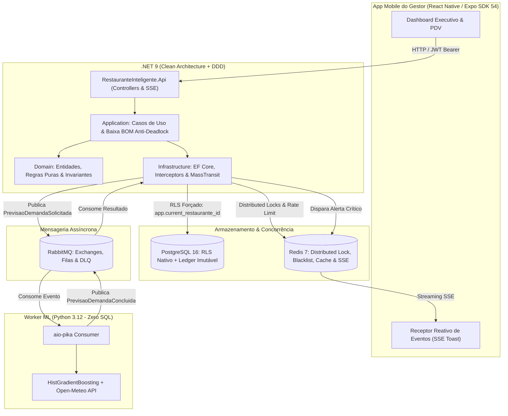

# Restaurante Inteligente · Sistema SaaS Multi-Tenant de Gestão & Previsão de Demanda

> **Projeto de Conclusão de Curso (TCC) em Engenharia de Software / Ciência da Computação**  
> **Autor:** Lucas Vicente  
> **Orientação Arquitetural:** Clean Architecture, DDD, Event-Driven Architecture (EDA) & Machine Learning Aplicado

[](https://dotnet.microsoft.com/)
[](https://www.postgresql.org/)
[](https://www.python.org/)
[](https://reactnative.dev/)
[](https://www.rabbitmq.com/)
[](https://redis.io/)
[](https://github.com/gregrymqt/Gestao-Restaurante/actions)
[](https://github.com/)

---

## 📌 1. Visão Geral e Justificativa do Projeto

No setor de alimentação fora do lar (restaurantes, bares e dark kitchens), o controle de estoque e a gestão de compras enfrentam dois problemas críticos e recorrentes:
1. **Desperdício Financeiro por Perecibilidade:** Compras excessivas de insumos perecíveis que estragam antes de serem consumidos.
2. **Ruptura Operacional de Estoque:** Esgotamento repentino de insumos essenciais em dias de pico, inviabilizando pratos do cardápio e gerando perda direta de receita e insatisfação do cliente.

O **Restaurante Inteligente** é uma plataforma SaaS *multi-tenant* projetada para resolver esse desafio cruzando **resiliência transacional de engenharia de software** com **inteligência preditiva de demanda**. O sistema prevê o consumo futuro com base no histórico de vendas e variáveis meteorológicas (temperatura e precipitação), calculando a capacidade máxima de produção da cozinha via Ficha Técnica (BOM - *Bill of Materials*) e alertando em tempo real sobre riscos iminentes de ruptura.

---

## 🏛️ 2. Arquitetura da Solução

O sistema é construído sobre uma topologia distribuída desacoplada, orientada a eventos assíncronos e segregada por inquilino (`RestauranteId`).



---

## 🛡️ 3. Pilares Técnicos e Diferenciais de Engenharia

### A. Segurança Multi-Tenant em Dupla Camada
1. **Camada de Aplicação:** Global Query Filters (`HasQueryFilter`) configurados no EF Core, interceptando todas as queries LINQ por `RestauranteId`.
2. **Camada Nativa de Banco:** **PostgreSQL Row-Level Security (`FORCE ROW LEVEL SECURITY`)**. Interceptores transacionais executam `SET LOCAL app.current_restaurante_id = '{id}'` a cada transação, tornando impossível o vazamento de dados entre restaurantes mesmo que ocorra uma falha na camada de software.

### B. Livro-Razão de Estoque (*Append-Only*)
A tabela `MovimentacoesEstoque` opera estritamente em modelo de ledger imutável. Não existem instruções `UPDATE` ou `DELETE` no histórico físico. O saldo na tabela `Insumos` atua como uma visão materializada aceleradora mantida atomicamente com o ledger e sujeita à auditoria contínua de integridade.

### C. Baixa de Ficha Técnica (BOM) Anti-Deadlock
Ao registrar vendas compostas no PDV, a baixa na ficha técnica expande os ingredientes, agrega volumes e ordena determinísticamente os registros por `InsumoId ASC` antes de solicitar bloqueios pessimistas (`SELECT ... FOR UPDATE`), eliminando matematicamente o risco de *deadlock* entre caixas concorrentes.

### D. Segregação Absoluta do Worker Python (*Zero SQL*)
O worker em Python responsável pelos modelos preditivos opera 100% desconectado do banco de dados relacional (proibição estrita de drivers relacionais como `psycopg2`, `asyncpg` ou `SQLAlchemy`). Todo o transporte é realizado via RabbitMQ com confirmação manual (`manual ack/nack`) e Dead Letter Queue (DLQ).

### E. Inteligência Preditiva com Dados Meteorológicos
O algoritmo de Machine Learning (`HistGradientBoostingRegressor`) correlaciona o histórico de movimentações com a previsão climática da API **Open-Meteo** (temperatura e probabilidade de chuva), prevendo variações sazonais de demanda com alta precisão e sem sobreajuste (*overfitting*).

---

## 🧪 4. Suíte de Testes Automatizados & Pipeline de CI/CD

O sistema conta com **mais de 217 testes automatizados** e um pipeline rigoroso de **CI/CD no GitHub Actions** que valida todos os contratos, tipagens e suítes de teste antes de permitir qualquer integração na branch `main`:

| Camada | Escopo dos Testes | Framework | Quantidade |
| :--- | :--- | :--- | :---: |
| **Banco PostgreSQL 16** | DDL Schema, Row-Level Security (`FORCE ROW LEVEL SECURITY`), Isolamento Cross-Tenant, Append-Only Ledger e Injeção IDOR | psql + scripts SQL | **6** |
| **Backend .NET 9** | Baixa de Estoque BOM, Deadlock, RLS, Refresh Tokens, Blacklist Redis, Rate Limiting, Fechamento de Caixa, Autenticação Anti-BOLA, Isolamento Cross-Tenant, RBAC, Paywall SaaS e Poder Discriminatório de Mutação | xUnit + FluentAssertions + Moq | **192** |
| **Worker ML Python** | Schemas Pydantic, Conexão AMQP, Idempotência Redis, Resiliência a Falhas e Inferência ML (Cláusula Zero-SQL auditada) | pytest + pytest-asyncio | **19** |
| **Frontend React Native** | Checagem de Variáveis de Ambiente Fail-Fast, Máscara/Sanitização de CNPJ, Toast SSE, RBAC/Sessão, Formatters e Paywall SaaS | node:assert + tsx | **6 Suítes** |
| **Total** | **Suíte Integrada Automatizada (Quality Gate)** | | **217+ Aprovados (100%)** |

```bash
# Executar suíte de testes do Backend C# (.NET 9)
dotnet test --verbosity minimal

# Executar suíte de testes do Worker Python (Zero-SQL)
& ml/.venv/Scripts/python.exe -m pytest ml/RestauranteInteligente.ML/tests/ -q

# Executar checagem estrita de tipos e testes do Frontend Mobile
cd src/frontend ; npx tsc --noEmit ; npx --yes tsx --test __tests__/*.test.ts
```

### 🛡️ Quality Gate & Regras de Proteção para a Branch `main`
O workflow `.github/workflows/ci.yml` orquestra sete estágios automatizados em paralelo:
1. `sql-ci`: Inicialização de contêiner PostgreSQL 16, carga do schema RLS, seeds e execução dos 6 testes discriminatórios nativos em SQL.
2. `backend-ci`: Compilação em Release do .NET 9 e execução dos 192 testes unitários.
3. `ml-worker-ci`: Validação estrita da Cláusula 1 (*Zero-SQL* - nenhum driver relacional permitido) e 19 testes `pytest`.
4. `frontend-ci`: Checagem de tipos estrita via TypeScript (`tsc --noEmit`) e 6 suítes unitárias com Node/TSX.
5. `docker-validation`: Compilação multi-stage dos contêineres Docker da WebApi, Worker ML e Gateway Nginx.
6. `quality-gate`: Portão de qualidade obrigatório; falhas em qualquer camada bloqueiam o PR e impedem o merge na branch `main`.
7. `cd-deploy`: Publicação automatizada das imagens de contêiner no GitHub Packages/Container Registry (`ghcr.io`) ao realizar push/merge confirmado na `main`.

---

## 🚀 5. Como Executar o Projeto Localmente

### Pré-requisitos
* [Docker & Docker Compose](https://www.docker.com/)
* [.NET 9 SDK](https://dotnet.microsoft.com/download/dotnet/9.0)
* [Python 3.12](https://www.python.org/)
* [Node.js 20+ & npm](https://nodejs.org/)

### Passo 1: Subir a Infraestrutura Distribuída
```bash
# Inicializa PostgreSQL 16, Redis 7 e RabbitMQ 3 com painel de gerenciamento
docker compose up -d
```
* **PostgreSQL:** `localhost:5432` (Database: `restaurante_db`)
* **Redis:** `localhost:6379`
* **RabbitMQ UI:** `http://localhost:15672` (Usuário: `admin` / Senha: `adminpassword`)

### Passo 2: Executar a API ASP.NET Core
```bash
dotnet run --project src/RestauranteInteligente.Api/RestauranteInteligente.Api.csproj
```
* A API iniciará em `http://localhost:5287` com documentação interativa Swagger em `/swagger`.

### Passo 3: Executar o Worker de Machine Learning
```bash
# Ativar ambiente virtual e iniciar worker
cd ml/RestauranteInteligente.ML
python -m uvicorn app.main:app --port 8000 --reload
```

### Passo 4: Executar o Aplicativo Mobile
```bash
cd src/frontend
npm install
npm start
```

---

## 🎬 6. Roteiro de Demonstração Interativa da Banca

O projeto conta com um script mestre interativo em PowerShell desenvolvido especificamente para guiar a banca examinadora durante a defesa:

```powershell
# Executar a suíte de demonstração ao vivo
.\scripts\apresentacao.ps1
```

### Funcionalidades do Console de Apresentação:
* **`[1] Demonstração Completa 1-Clique (Ciclo E2E):`** Autentica o operador, simula vendas de pratos compostos no PDV, processa a baixa determinística de insumos, dispara o cálculo preditivo da IA no RabbitMQ e alerta sobre insumos em risco de ruptura.
* **`[2] Relatório de Capacidade Produtiva & Previsão da IA:`** Cruza o saldo de estoque com a demanda prevista, identificando visualmente os itens gargalo que limitam a produção da cozinha.
* **`[3] Execução da Suíte de Testes (138 Testes):`** Roda os testes de ponta a ponta demonstrando estabilidade imediata.
* **`[4] Verificação de Saúde dos Microsserviços:`** Checa a conectividade de todas as portas ativas (5432, 6379, 5672, 5287, 8000).
* **`[7] Auditoria de Banco de Dados & RLS:`** Executa auditoria no PostgreSQL e gera o arquivo [`SCHEMA_BANCO.md`](SCHEMA_BANCO.md) com todas as tabelas, tipos de dados estritos e políticas de Row-Level Security ativas.

---

## 📂 7. Estrutura de Diretórios

```
Gestao-Restaurante/
├── ml/                                 # Worker assíncrono de Inteligência Artificial (Python 3.12)
│   └── RestauranteInteligente.ML/      # Pipeline de previsão (HistGradientBoosting + Open-Meteo)
├── scripts/                            # Automações de demonstração e simulação E2E para a banca
│   ├── apresentacao.ps1                # Script Master interativo para a defesa de TCC
│   └── e2e-simulation.ps1              # Simulação de carga e concorrência no PDV
├── src/
│   ├── frontend/                       # Aplicativo Mobile em React Native (Expo SDK 54)
│   ├── RestauranteInteligente.Api/     # Endpoints HTTP, Middlewares e Streaming SSE
│   ├── RestauranteInteligente.Application/ # Casos de Uso, Orquestração e Lógica de BOM
│   ├── RestauranteInteligente.Domain/  # Entidades de Domínio, Regras Puras e Interfaces
│   └── RestauranteInteligente.Infrastructure/ # EF Core, PostgreSQL RLS, Redis e RabbitMQ
├── tests/
│   └── RestauranteInteligente.UnitTests/ # Suíte de 119 testes unitários do Backend (.NET 9)
├── docker-compose.yml                  # Orquestração de containers de infraestrutura
└── SCHEMA_BANCO.md                     # Dicionário de dados auditado do PostgreSQL
```

---

## 📜 Licença e Direitos Acadêmicos
Desenvolvido por **Lucas Vicente** como Trabalho de Conclusão de Curso (TCC). Uso acadêmico e livre para fins educacionais.
